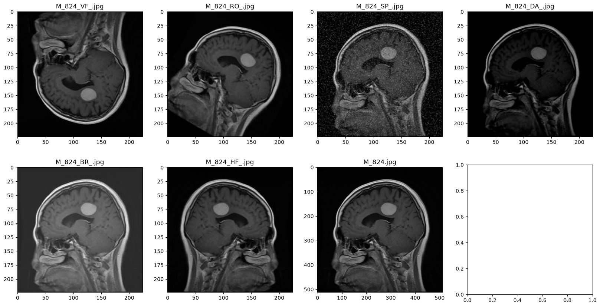
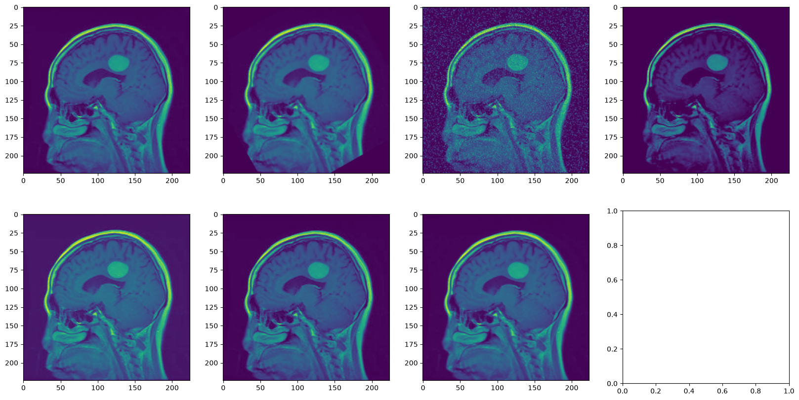
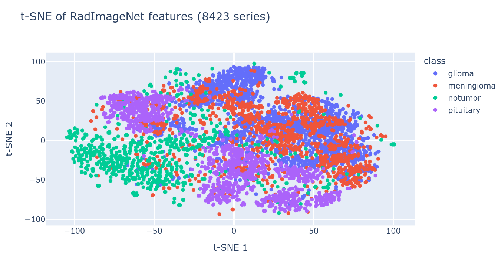
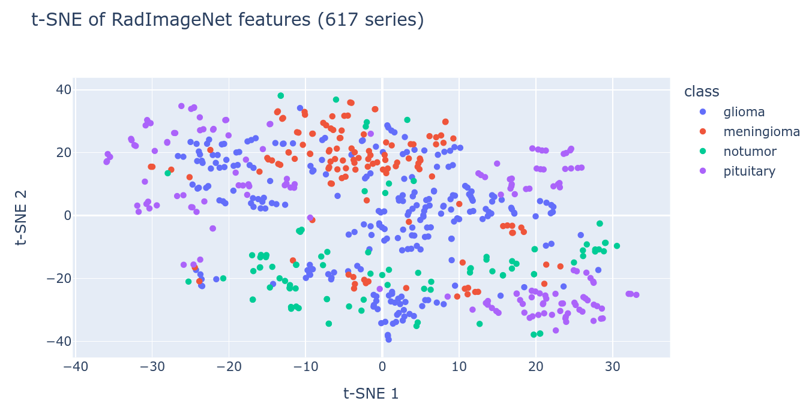

# Отчёт о проделанной работе

## 1. Данные

В работе использовались два представления одного и того же набора МРТ-снимков.

1. **Single-image (raw)** — исходные одиночные изображения из
   `data/Epic and CSCR hospital Dataset`. Один снимок подаётся в модель как
   grayscale-изображение `1 × 224 × 224`.
2. **Multi-band (aligned)** — многоканальные исследования из
   `data/aligned`. Для одного исследования объединяются до шести модальностей:
   `BR`, `DA`, `HF`, `RO`, `SP`, `VF`. В модель подаётся тензор
   `6 × 224 × 224`.

### Распределение исходного датасета

Таблица описывает распределение файлов по модальностям в исходных папках.
`no_mod` — снимки без суффикса модальности (одиночные изображения),
`other` — файлы с нераспознанной модальностью.

```
Split  Class           BR    DA    HF    RO    SP    VF  other  no_mod
----------------------------------------------------------------------
Train  glioma         193   192   191   192   193   193      0    1864
Train  meningioma      69    70    70    69    69    69      0    1767
Train  notumor         92    92    92    90    90    91      0    1398
Train  pituitary      153   152   152   153   153   152      0    1589
Test   glioma          47    47    47    46    46    46      0     476
Test   meningioma      56    55    55    55    55    54      0     216
Test   notumor          0     0     0     0     0     0      0     487
Test   pituitary        0     0     0     0     0     0      0     626
```

Важно: это распределение файлов, а не итоговые размеры выборок для обучения.
Для single-image модели группы модальностей схлопываются в одно базовое
изображение исследования. В результате получается:

- **Train:** 6621 базовое изображение;
- **Test:** 1805 базовых изображений.

Для multi-band модели после выравнивания и дедупликации:

- **617 серий** до дедупликации: 513 в `Train`, 104 в `Test`;
- **600 уникальных серий** после дедупликации;
- итоговое честное разбиение: **480 train / 120 test**, плюс 4-fold CV
  на train-части (примерно по 120 серий в валидационном фолде).

В исходном `Test` многоканальные серии есть только для `glioma` и
`meningioma`; `notumor` и `pituitary` представлены только одиночными снимками.

### Выравнивание multi-band изображений

Модальности одного исследования были по-разному повёрнуты и отражены, поэтому
перед объединением в 6-канальный тензор их нужно было привести к общему
пространственному положению. Для этого использовались ORB-признаки, сопоставление
дескрипторов и оценка аффинного преобразования через RANSAC. Для каждого снимка
подбирались поворот и отражение относительно референсной модальности.

**До выравнивания**



**После выравнивания**



### Утечка данных (data leak)

В исходном разбиении на `Train` и `Test` одни и те же исследования попадали в
разные папки. Например, для исследования `G_675` базовое изображение и одна
модальность находились в `Train`, а остальные модальности — в `Test`:

```
./data/Epic and CSCR hospital Dataset/Train/glioma/G_675_BR_.jpg
./data/Epic and CSCR hospital Dataset/Test/glioma/G_675_VF_.jpg
./data/Epic and CSCR hospital Dataset/Test/glioma/G_675_RO_.jpg
./data/Epic and CSCR hospital Dataset/Test/glioma/G_675_DA_.jpg
./data/Epic and CSCR hospital Dataset/Test/glioma/G_675_HF_.jpg
./data/Epic and CSCR hospital Dataset/Test/glioma/G_675_SP_.jpg
```

Из-за этого исходный `Test` нельзя использовать как независимую оценку.
Для single-image модели дополнительно сворачиваются группы модальностей в одно
базовое изображение, но исходное разбиение всё равно содержит пересечения,
поэтому честная оценка делается на 20% holdout из `Train`.

Для multi-band данных **все данные были перемешаны и заново разбиты**:
`Train` и `Test` объединены, выполнена дедупликация по содержимому и
`(class, series_id)`, после чего сделано стратифицированное разбиение 80/20
с сохранением групп. Серии одного исследования не попадают одновременно в
train и test.

## 2. Модель

В качестве основы взята предварительно обученная на **RadImageNet** модель
**ResNet50** (`Lab-Rasool/RadImageNet`, файл `ResNet50.pt`).

- Все слои backbone заморожены.
- Обучается только последний линейный слой `Linear(2048, 4)`.
- Классификация выполняется по четырём классам: `glioma`, `meningioma`,
  `notumor`, `pituitary`.
- Функция потерь — `CrossEntropyLoss`.

Для single-image входа веса первого свёрточного слоя, рассчитанные на 3
RGB-канала, усредняются в один grayscale-канал.

Для multi-band входа веса первого свёрточного слоя дублируются с 3 до 6
каналов, чтобы модель могла принимать все шесть модальностей.

На t-SNE признаков RadImageNet видно, что классы в значительной степени
разделимы, поэтому обучение только последнего слоя является достаточным:





## 3. Аугментация

Для multi-band модели применяется аугментация, общая для всех шести каналов:
все геометрические преобразования выполняются над стеком `H × W × 6`, поэтому
модальности остаются согласованными.

Используются:

- **ChannelDropout** с вероятностью `0.2` для каждого канала — имитация
  отсутствующих модальностей; канал целиком зануляется;
- `Affine`: сдвиг до 5%, масштаб `0.9–1.1`, поворот `±15°`, `p=0.7`;
- `HorizontalFlip`, `p=0.5`;
- `RandomResizedCrop` до `224 × 224`, `p=0.5`;
- `RandomBrightnessContrast` с лимитами `0.1`, `p=0.5`;
- `RandomGamma` в диапазоне `90–110`, `p=0.3`;
- слабый `GaussNoise`, `p=0.2`;
- слабый `GaussianBlur`, `p=0.1`;
- `RingingOvershoot` как имитация МРТ-артефактов, `p=0.05`.

Для валидации и теста используется только `Resize(224, 224)`.

Для single-image модели аугментация не применялась: изображение приводится к
`224 × 224` и масштабируется в `[0, 1]`.

Для multi-band данных после аугментации применяется нормализация по правилу
«трёх сигм» по ненулевым (не чёрным) пикселям.

## 4. Обучение

| Параметр | Single-image (raw) | Multi-band (aligned, CV) |
|---|---|---|
| Optimizer | AdamW | AdamW |
| Learning rate | `1e-3` | `2e-3` (фактический запуск) |
| Weight decay | `1e-4` | `1e-4` |
| Batch size | 32 | 32 |
| Эпох | 100 | 200 |
| Train / val / test | 5296 / 1325 / 1805 (исходный Test) | 480 / ~120 на фолд / 120 |
| Early stopping | `patience=10`, по `val_loss` | `patience=200` (фактически без остановки) |
| Лучший чекпоинт | эпоха 38, `val_loss=0.2661` | эпоха 179, `val_loss=0.4668` |

Ранняя остановка отслеживает только `val_loss`; тест не используется для
выбора эпохи или остановки обучения.

Single-image модель обучалась на 80% `Train` (5296 изображений), валидация —
20% `Train` (1325 изображений). Исходный `Test` (1805 изображений) содержит
утечку, поэтому для честной оценки используется holdout из `Train`.

Multi-band модель обучалась с 4-fold кросс-валидацией на 480 сериях; на каждом
фолде валидация содержала около 120 серий. После кросс-валидации модель
обучена на всех 480 сериях, а 120 серий использованы как отложенный test.

### Результаты кросс-валидации multi-band модели

```
CV mean±std: loss=0.5441±0.1380 acc=0.8332±0.0451 f1=0.8088±0.0621 precision=0.8322±0.0481 recall=0.8118±0.0681 sensitivity=0.8118±0.0681 specificity=0.9431±0.0163
```

```
[test] checkpoint=wandb/run-20261017_202512-cyg0yhoz/files/best.pt epoch=38 val_loss=0.2660983196744379 in_channels=1 head_dims=[4]
[test] dataset=raw split=raw Train holdout (80/20, seed=42) root='data/Epic and CSCR hospital Dataset' samples=1325 classes=['glioma', 'meningioma', 'notumor', 'pituitary'] device=cuda
[test] loss=0.2661 acc=0.9147 f1=0.9174 precision=0.9157 recall=0.9201 sensitivity=0.9201 specificity=0.9713
```

```
[test] checkpoint=wandb/run-20261017_215657-mb02wu62/files/best.pt epoch=179 val_loss=0.46680214802424114 in_channels=6 head_dims=[4]
[test] dataset=aligned split=aligned cross-validation holdout (80/20, seed=42) root='data/aligned' samples=120 classes=['glioma', 'meningioma', 'notumor', 'pituitary'] device=cuda
[test] loss=0.4668 acc=0.8750 f1=0.8676 precision=0.8692 recall=0.8685 sensitivity=0.8685 specificity=0.9561
```

## 5. Использование

### Установка и подготовка данных

```bash
uv sync
uv run download_data
uv run align_data \
  --root "data/Epic and CSCR hospital Dataset" \
  --out data/aligned
```

### Обучение single-image модели

```bash
uv run train_model \
  --dataset raw \
  --epochs 100 \
  --batch-size 32 \
  --lr 1e-3 \
  --weight-decay 1e-4 \
  --patience 10
```

### Обучение multi-band модели с кросс-валидацией

```bash
uv run cross_validate \
  --root data/aligned \
  --n-splits 4 \
  --epochs 200 \
  --batch-size 32
```

В фактическом запуске использовался `lr=2e-3` (см. таблицу выше); в текущем
`cross_validate` learning rate берётся из значения по умолчанию тренера.

### Проверка обученных моделей

```bash
# Single-image: честный 20% holdout из Train (тот же seed, что при обучении)
uv run test_model \
  --checkpoint wandb/run-20261017_202512-cyg0yhoz/files/best.pt \
  --dataset raw \
  --split test

# Multi-band: holdout, использованный в кросс-валидации
uv run test_model \
  --checkpoint wandb/run-20261017_215657-mb02wu62/files/best.pt \
  --dataset aligned \
  --split cv

# Исходный Test-каталог (содержит утечку; только для сравнения)
uv run test_model \
  --checkpoint wandb/run-20261017_202512-cyg0yhoz/files/best.pt \
  --dataset raw \
  --split test-dir
```

Вместо путей из `wandb/` можно указать любой сохранённый `best.pt` или
`last.pt`.

### Инференс из Python

```python
import cv2

from brain_hackathon.eval import BestModels

models = BestModels()

# Одиночный grayscale-снимок
image = cv2.imread("path/to/image.jpg", cv2.IMREAD_GRAYSCALE)
probabilities = models.predict(image)
class_name, confidence = models.top_class(probabilities)
print(class_name, confidence)

# 6-канальный стек H x W x 6 — модель определится автоматически
# stack = ...
# probabilities = models.predict(stack)
```

Для сравнения двух моделей на одном изображении можно использовать
`models.predict_both(image)`: метод возвращает распределения от single-image
модели, multi-band модели и их усреднённый ансамбль.
